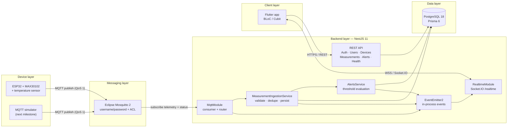
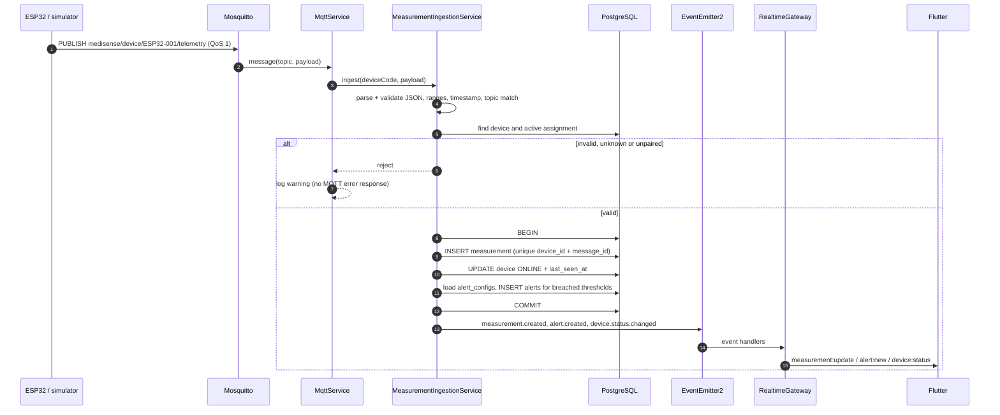
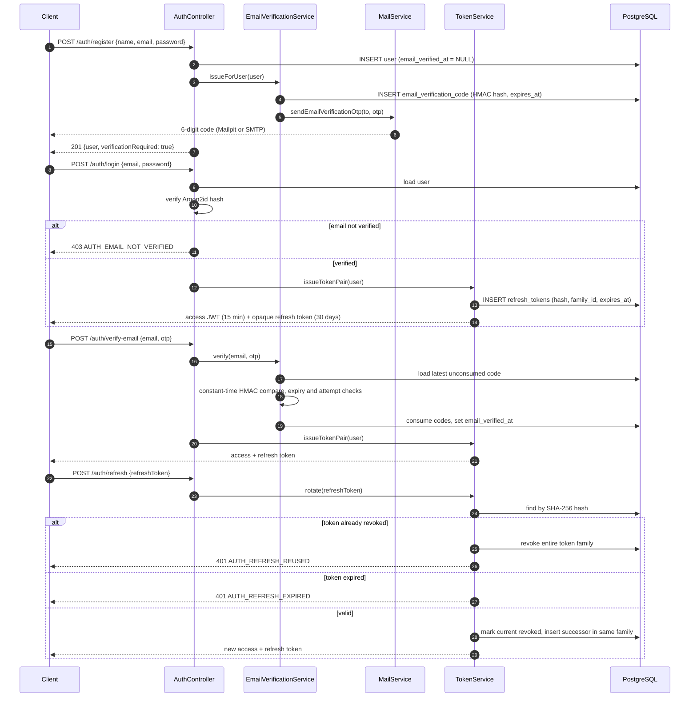
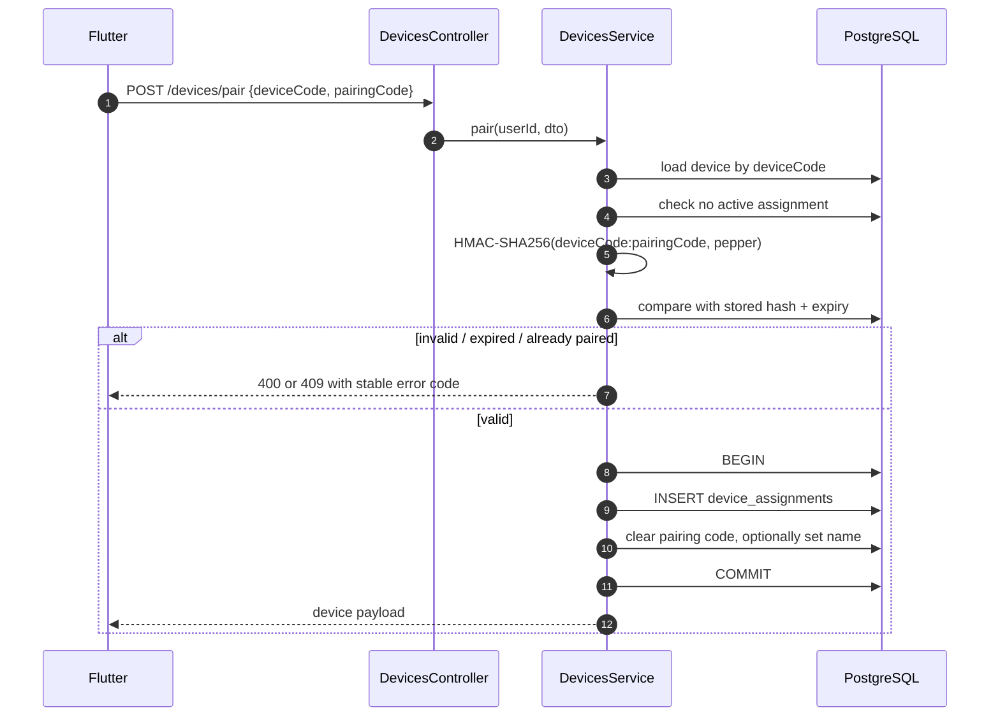
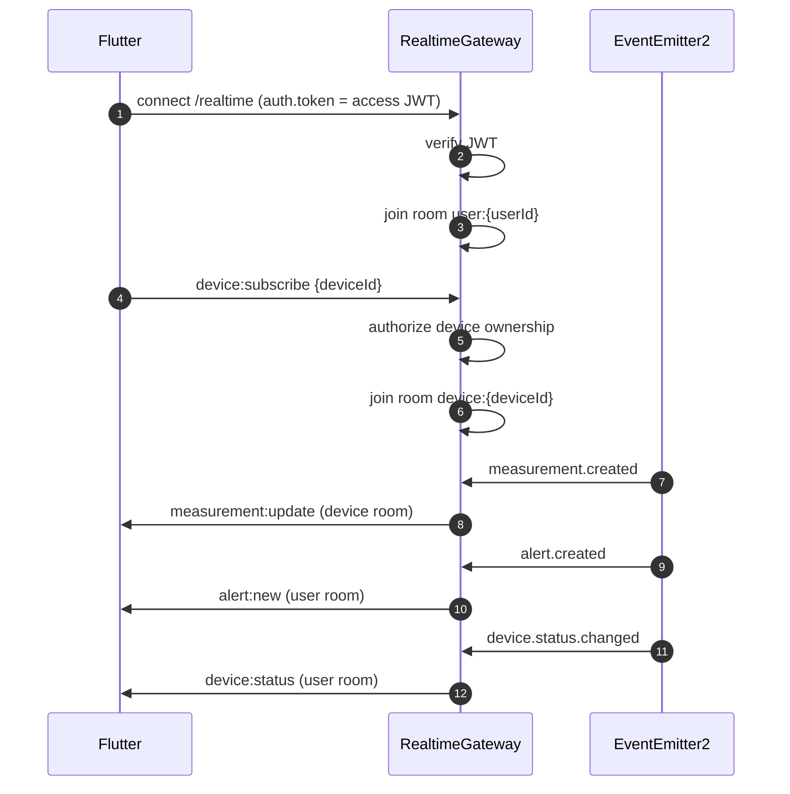
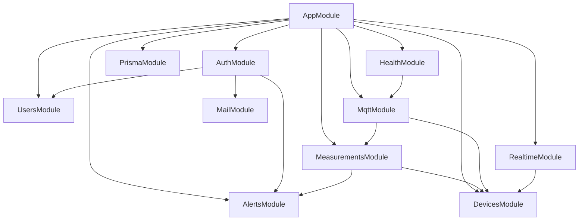
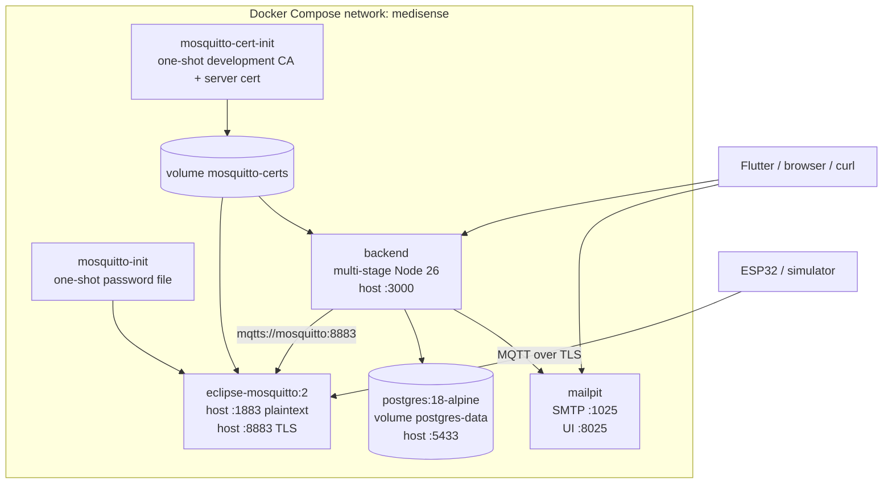

# MediSense — System Architecture

> Portfolio / demonstration system. Measurements and alerts are **not** medical
> diagnoses and must not be used for clinical decisions. Sensor accuracy and
> algorithms must be validated separately before any real-world health use.

This document describes the architecture that is implemented in this repository.
The product requirements live in the HTTP, WebSocket and
MQTT contracts live in [`api-specification.md`](./api-specification.md).

---

## 1. Scope of the implemented milestone

| Area | Status |
| --- | --- |
| REST API (auth, users, devices, measurements, alerts, health) | Implemented |
| Email verification via 6-digit OTP | Implemented |
| PostgreSQL schema + migrations + seed | Implemented |
| MQTT ingestion (telemetry + device status/LWT) | Implemented |
| Socket.IO real-time gateway | Implemented |
| Docker Compose (PostgreSQL, Mailpit, Mosquitto with TLS, backend) | Implemented |
| Unit tests | Implemented |
| Database-backed API e2e tests | Implemented, opt-in locally via `TEST_DATABASE_URL`; run in GitHub Actions |
| CI (format, build, unit, e2e) | Implemented in `.github/workflows/ci.yml` |
| PDF export, push notifications, caregiver/admin | Out of scope |
| MQTT simulator application | Next milestone |
| ESP32 firmware | Next milestone |

The backend is a single NestJS 11 application. It exposes three entry points:

1. **HTTP** on `:3000` under `/api/v1` (plus `/health/*` and `/docs`).
2. **MQTT client** connected to Mosquitto over TLS on `:8883`
   (`mqtts://`); a plaintext `:1883` listener exists for local debugging.
3. **Socket.IO** namespace `/realtime` on the same HTTP server.

---

## 2. High-level architecture



### Why MQTT and WebSocket are both used

- **MQTT** is the device-facing protocol. It is lightweight, supports QoS and
  Last Will and Testament, and keeps devices behind a broker instead of exposing
  them to the API.
- **WebSocket (Socket.IO)** is the client-facing real-time channel. Flutter
  never talks to the broker; it authenticates with a JWT and receives only data
  it is authorized to see.
- **REST** handles authentication, configuration, device management and
  historical queries.

---

## 3. Component responsibilities

### 3.1 Edge devices

The ESP32 firmware (or simulator) is responsible for:

- sampling the MAX30102 (heart rate / SpO2) and temperature sensor,
- filtering and validating raw readings,
- assigning a unique `messageId` and a monotonic `sequence`,
- publishing a JSON telemetry payload to
  `medisense/device/{deviceCode}/telemetry` with QoS 1,
- publishing `online`/`offline` status and configuring an MQTT Last Will,
- buffering locally and retrying while the network is unavailable.

Devices only know the broker and their own credentials. They never call the REST
API and never receive user tokens.

### 3.2 Mosquitto

- Authenticates every client with a username/password file.
- Enforces a topic ACL:
  - the backend user may read every device's telemetry/status and write
    commands,
  - each device may publish only its own `%u` topics.
- Persists queued messages and supports retained status messages.
- Runs as the only component exposed to devices on the network.

### 3.3 NestJS backend

| Module | Responsibility |
| --- | --- |
| `AuthModule` | Register, email OTP verification, login, refresh rotation, logout, JWT signing |
| `MailModule` | Console/SMTP delivery of verification emails |
| `UsersModule` | Profile read/update, password change |
| `DevicesModule` | Pairing, unpairing, rename, presence sweeper, device connection alerts |
| `MeasurementsModule` | Telemetry ingestion, history, latest, series |
| `AlertsModule` | Threshold configuration, evaluation, alert history, device connection alerts |
| `MqttModule` | Broker connection, topic routing, status handling |
| `RealtimeModule` | Socket.IO authentication, rooms, event fan-out |
| `HealthModule` | Liveness and readiness probes |
| `PrismaModule` | Global database client |
| `common/` | Guards, filters, error model, pagination, crypto/password utils |
| `config/` | Joi environment validation |

Cross-cutting behaviour:

- **Global guards**: throttling first, then JWT authentication. Routes marked
  `@Public()` skip JWT.
- **Global validation pipe**: whitelist + `forbidNonWhitelisted`, so unknown body
  or query fields produce `400`.
- **Global exception filter**: maps exceptions to RFC 9457-style
  `application/problem+json` with a stable `code`.
- **Structured logging**: `nestjs-pino` with request IDs and redaction of
  authorization headers, cookies, passwords and refresh tokens.
- **Swagger**: generated from decorators and DTOs at `/docs`.

### 3.4 PostgreSQL

PostgreSQL is the system of record for users, email verification codes, sessions,
devices, assignments, measurements, thresholds and alerts. Prisma provides the
typed client and migrations. The schema is described in section 6.

### 3.5 Flutter client

The Flutter app (separate milestone) uses the REST API for auth, configuration
and history, and keeps a Socket.IO connection for live data. Recommended client
behaviour:

- refresh the access token before expiry and reconnect the socket with the new
  token,
- re-join the device room after a reconnect,
- use REST snapshots (`/measurements/latest`, `/measurements/series`) to
  bootstrap the UI, then apply WebSocket deltas,
- reconnect with exponential backoff and show a connection indicator.

---

## 4. Data flows

### 4.1 Telemetry ingestion



Key rules:

- The payload `deviceCode` must equal the device code in the MQTT topic.
- `(device_id, message_id)` is unique; a duplicate publish is silently ignored
  (idempotency).
- The device must have an **active** `device_assignments` row. Unknown or
  unpaired devices are rejected.
- Ingestion runs in a single database transaction, so a measurement and its
  alerts are committed atomically.
- MQTT has no request/response channel here. Rejections are logged and never
  published back, which avoids leaking validation details to unauthenticated
  publishers.

### 4.2 Alert evaluation

1. The ingestion service loads the user's `alert_configs` inside the transaction.
2. For each parameter present in the measurement, it compares the value with
   `min_value` / `max_value`.
3. A breach creates an `alerts` row with a human-readable English message, the
   direction (`LOW` / `HIGH`) and the thresholds that were active at the time.
4. At most one alert per `(measurement_id, parameter)` is created.
5. Alerts are streamed to the owner's room as `alert:new`.

Default thresholds (seeded and used as fallback when a row is missing):

| Parameter | Min | Max |
| --- | --- | --- |
| `HEART_RATE` | 50 bpm | 100 bpm |
| `SPO2` | 95 % | 100 % |
| `TEMPERATURE` | 36.1 °C | 37.5 °C |

Thresholds are a demonstration feature, not a clinical alarm system.

**Device connection alerts.** When a paired device transitions from `ONLINE` to
`OFFLINE` (MQTT Last Will, an explicit `offline` status, or the presence
sweeper), the backend writes an `alerts` row with
`parameter = DEVICE_CONNECTION`. The row has no measurement, numeric value or
direction, so those columns are nullable. The transition is performed with a
conditional `UPDATE ... WHERE status = 'ONLINE'` inside the same transaction as
the alert insert; concurrent triggers therefore produce exactly one alert per
outage. User-initiated unpairing does not create a disconnected alert. The alert
is returned by `GET /alerts` and pushed as `alert:new`.

### 4.3 Authentication, email verification and session rotation



Properties:

- Registration never returns tokens. A 6-digit OTP is emailed and only its
  HMAC-SHA256 hash (`userId:otp`, `EMAIL_OTP_PEPPER`) is stored.
- Codes expire after `EMAIL_OTP_TTL_MINUTES` (default 10), allow
  `EMAIL_OTP_MAX_ATTEMPTS` failures (default 5), and resend is limited to one
  code per `EMAIL_OTP_RESEND_COOLDOWN_SECONDS` (default 60).
- `POST /auth/verify-email` consumes every outstanding code and issues a token
  pair immediately. `POST /auth/resend-verification` always returns the same
  generic response so account existence cannot be enumerated.
- Access tokens are short-lived JWTs signed with `JWT_ACCESS_SECRET`
  (HS256) and include `sub`, `email`, `role`, `iss`, `aud`.
- Refresh tokens are opaque random strings. Only their SHA-256 hash is stored.
- Every rotation issues a new token in the same `family_id`; reusing a revoked
  token revokes the whole family (theft detection).
- Logout revokes one token; logout-all and password change revoke all active
  tokens for the user.
- Access tokens remain stateless and valid until expiry after logout. Clients
  must discard them immediately.

### 4.4 Device pairing



- Pairing codes are six digits, stored only as
  `HMAC-SHA256("<deviceCode>:<code>", PAIRING_CODE_PEPPER)` with an expiry.
- A partial unique index guarantees at most **one active assignment per
  device**.
- Unpairing sets `unassigned_at` and marks the device offline (no disconnected
  alert is created because the user initiated it). Measurements and alerts keep
  their `user_id`, so history is preserved.
- A user who previously paired a device may request a new code after unpairing
  via `POST /devices/:id/pairing-code`.
- For local development only, `PAIRING_ALLOW_DEVICE_CODE=true` allows pairing
  with `deviceCode` alone (no code). It must be `false` in production.
- **Device discovery is out of scope for the backend.** Scanning for nearby
  BLE/ESP32 devices and showing them in the app belongs to the Flutter client
  (with firmware support for advertising). The backend only pairs a known
  `deviceCode`, so discovery never grants access: pairing still requires the
  device row and, outside development pairing, a valid pairing code.
- **MQTT credentials are provisioned manually.** This milestone has no device
  provisioning API. Adding a physical device means creating its row (seed or
  database), adding a broker user to the `mosquitto-init` password file, and
  giving the firmware the generated username/password. The ACL limits each
  device to its own topics.

### 4.5 Presence and offline detection

Two independent mechanisms keep `devices.status` accurate:

1. **Explicit status / LWT**: the device publishes
   `{ "status": "online" }` on connect and configures a retained
   `{ "status": "offline" }` Last Will. The broker publishes the will when the
   connection drops unexpectedly.
2. **Idle sweeper**: every `DEVICE_SWEEPER_INTERVAL_MS` (default 30 s), the
   backend marks `ONLINE` devices whose `last_seen_at` is older than
   `DEVICE_OFFLINE_THRESHOLD_SECONDS` (default 90 s) as `OFFLINE`.

Every telemetry message also refreshes `last_seen_at` and sets the device
`ONLINE`. Status changes are emitted as `device:status` to the owner's room. An
`ONLINE → OFFLINE` transition is applied with a conditional update in the same
transaction that inserts one `DEVICE_CONNECTION` alert, which deduplicates
concurrent LWT/sweeper triggers and also emits `alert:new`.

### 4.6 WebSocket fan-out



- The gateway authenticates during the Socket.IO handshake using
  `auth.token` (or an `Authorization: Bearer` header).
- Invalid tokens are disconnected immediately.
- `measurement:update` is scoped to a device room so a user can subscribe only
  to devices they own.
- Alerts and device status are scoped to the user room (all of the user's
  sessions).
- Domain services never import the gateway. They emit typed events through
  `EventEmitter2`, keeping ingestion/testing independent of Socket.IO.

---

## 5. Backend internals

### 5.1 Module dependency graph



`JwtModule` is registered as global by `AuthModule`, so guards and the gateway
can verify tokens without importing the module explicitly.

### 5.2 Error model

All HTTP errors use `application/problem+json`:

```json
{
  "type": "about:blank",
  "title": "Bad Request",
  "status": 400,
  "detail": "Request validation failed.",
  "code": "VALIDATION_ERROR",
  "details": { "errors": ["email must be an email"] },
  "instance": "/api/v1/auth/register",
  "requestId": "0b6c2d4e-...",
  "timestamp": "2026-11-07T10:15:30.000Z"
}
```

- `code` is stable and intended for client branching.
- Prisma `P2002` (unique constraint) maps to `409 CONFLICT`, `P2025` to `404`.
- Unexpected failures are logged with the request ID and return `500` without
  leaking internals.
- WebSocket errors are emitted to the socket as an `exception` event.

### 5.3 Pagination

History endpoints use opaque cursor pagination:

- cursor = `base64url("<ISO measuredAt or createdAt>|<uuid>")`,
- ordering is descending by timestamp then `id`,
- the response includes `meta.limit`, `meta.hasMore`, `meta.nextCursor`,
- malformed cursors return `400 INVALID_CURSOR`.

### 5.4 Time-series aggregation

`GET /measurements/series` uses PostgreSQL `date_bin` to bucket rows and
`AVG()` to produce chart points. This requires PostgreSQL 14+; the project uses
PostgreSQL 18. The range is limited to 5,000 buckets to protect the database.

### 5.5 Configuration validation

Joi validates the environment at boot. Important constraints:

- `DATABASE_URL` is required.
- `JWT_ACCESS_SECRET` must be at least 32 characters.
- `PAIRING_CODE_PEPPER` must be at least 16 characters.
- `EMAIL_OTP_PEPPER` must be at least 16 characters.
- `MAIL_TRANSPORT` accepts `console` (default) or `smtp`; `SMTP_HOST`,
  `SMTP_PORT`, `SMTP_SECURE`, `SMTP_USER`, `SMTP_PASSWORD` and `SMTP_FROM`
  configure delivery.
- `EMAIL_OTP_TTL_MINUTES` (default 10), `EMAIL_OTP_MAX_ATTEMPTS` (default 5) and
  `EMAIL_OTP_RESEND_COOLDOWN_SECONDS` (default 60) tune the OTP policy.
- Unknown environment variables are allowed (so the container runtime can add
  its own), but every documented variable is type-checked and defaulted.
- Validation failure aborts startup with a clear error.

---

## 6. Data model

```mermaid
erDiagram
  USERS ||--o{ REFRESH_TOKENS : owns
  USERS ||--o{ EMAIL_VERIFICATION_CODES : verifies
  USERS ||--o{ DEVICE_ASSIGNMENTS : has
  DEVICES ||--o{ DEVICE_ASSIGNMENTS : assigned
  USERS ||--o{ MEASUREMENTS : owns
  DEVICES ||--o{ MEASUREMENTS : produces
  USERS ||--o{ ALERT_CONFIGS : configures
  USERS ||--o{ ALERTS : receives
  DEVICES ||--o{ ALERTS : triggers
  MEASUREMENTS ||--o{ ALERTS : causes

  USERS {
    uuid id PK
    varchar name
    varchar email UK
    varchar password_hash
    enum role
    varchar timezone
    timestamptz email_verified_at
    timestamptz created_at
    timestamptz updated_at
  }

  EMAIL_VERIFICATION_CODES {
    uuid id PK
    uuid user_id FK
    varchar code_hash
    timestamptz expires_at
    timestamptz consumed_at
    int attempts
    timestamptz created_at
  }

  REFRESH_TOKENS {
    uuid id PK
    uuid user_id FK
    varchar token_hash UK
    uuid family_id
    timestamptz expires_at
    timestamptz revoked_at
    uuid replaced_by_token_id
    varchar ip
    varchar user_agent
    timestamptz created_at
  }

  DEVICES {
    uuid id PK
    varchar device_code UK
    varchar name
    varchar type
    enum status
    varchar firmware_version
    varchar pairing_code_hash
    timestamptz pairing_code_expires_at
    timestamptz last_seen_at
    timestamptz created_at
    timestamptz updated_at
  }

  DEVICE_ASSIGNMENTS {
    uuid id PK
    uuid user_id FK
    uuid device_id FK
    timestamptz assigned_at
    timestamptz unassigned_at
  }

  MEASUREMENTS {
    uuid id PK
    uuid device_id FK
    uuid user_id FK
    varchar message_id
    bigint sequence
    int heart_rate
    int spo2
    decimal temperature
    enum signal_quality
    timestamptz measured_at
    timestamptz received_at
  }

  ALERT_CONFIGS {
    uuid id PK
    uuid user_id FK
    enum parameter
    decimal min_value
    decimal max_value
    boolean enabled
    timestamptz updated_at
  }

  ALERTS {
    uuid id PK
    uuid user_id FK
    uuid device_id FK
    uuid measurement_id FK?   // null for DEVICE_CONNECTION alerts
    enum parameter
    decimal value?            // null for DEVICE_CONNECTION alerts
    decimal min_value
    decimal max_value
    enum direction?           // null for DEVICE_CONNECTION alerts
    enum status
    varchar message
    timestamptz created_at
    timestamptz read_at
  }
```

### 6.1 Design decisions

**Email verification codes.** `users.email_verified_at` gates login. Each code
row stores an HMAC-SHA256 hash of `<user_id>:<otp>` (never the raw OTP), an
expiry, an attempt counter and a `consumed_at` marker. A new code consumes all
older codes for the user, and successful verification consumes the rest.
Existing accounts are backfilled as verified by the migration so they are not
locked out.

**`user_id` on measurements and alerts.** The active assignment is enough to
authorize ingestion, but denormalizing the owner onto each row means history
queries never need to join through `device_assignments`, and history survives an
unpair. Authorization is a simple `WHERE user_id = ...`.

**Assignment history instead of a `user_id` column on devices.** A device can be
paired, unpaired and paired again. Keeping assignment rows preserves the audit
trail and allows a single device to move between accounts over time.

**One active assignment per device.** Prisma cannot express partial unique
indexes, so the migration adds:

```sql
CREATE UNIQUE INDEX "device_assignments_active_device_unique"
  ON "device_assignments"("device_id")
  WHERE "unassigned_at" IS NULL;
```

**Idempotency.** `@@unique([deviceId, messageId])` makes telemetry replay-safe.
Duplicate MQTT deliveries (QoS 1 is at-least-once) are ignored.

**Alert deduplication.** `@@unique([measurementId, parameter])` prevents two
threshold alerts for the same parameter on the same measurement. Device
connection alerts have a `NULL` measurement id (PostgreSQL treats `NULL`s as
distinct) and are deduplicated by the atomic `ONLINE → OFFLINE` status
transition instead.

**Indexes.** Descending composite indexes on
`(user_id, measured_at)`, `(device_id, measured_at)` and
`(user_id, created_at)` support the history and alert feeds. Additional indexes
on `(user_id, heart_rate)` and `(user_id, spo2)` support future filtering.

**Timestamps.** All timestamps use `timestamptz(3)` and are serialized as ISO
8601 UTC strings.

---

## 7. Security architecture

| Concern | Control |
| --- | --- |
| Password storage | Argon2id (`@node-rs/argon2`, memory 19 MiB, 2 iterations) |
| Access tokens | Short-lived HS256 JWT, issuer/audience checked |
| Refresh tokens | 384-bit random, SHA-256 hashed at rest, rotated, reuse detection |
| Email verification | 6-digit OTP, HMAC-SHA256 with pepper, 10 min TTL, 5 attempts, 60 s resend cooldown, constant-time compare |
| Account enumeration | Generic resend response and identical invalid-credential message |
| Pairing codes | HMAC-SHA256 with pepper, expiry, cleared after use |
| Authorization | Every device/measurement/alert query scoped by `user_id` |
| Cross-account access | Returns `404` (does not reveal resource existence) |
| MQTT | Username/password, ACL, per-device topic restriction, TLS listener (8883) with CA verification |
| WebSocket | JWT verified during handshake; room joins authorize device ownership |
| Input validation | DTO validation, telemetry range/timestamp checks, 64 KB body limit |
| Rate limiting | Global 100 req/min/IP; stricter auth limits |
| Headers | Helmet, CORS allowlist |
| Logging | pino redaction of auth headers, cookies, passwords, refresh tokens |
| Transport | HTTP TLS terminated at a reverse proxy in production; MQTT over TLS (8883) in the Compose stack |

Security notes and deliberate trade-offs:

- JWT access tokens are stateless. Logout prevents refresh but cannot revoke an
  already issued access token before its 15-minute expiry.
- The throttler is in-memory. Multiple backend replicas would each keep their
  own counters; production should use a shared store (e.g. Redis).
- The MQTT client uses a fixed `clientId` and `clean: false`. Only one backend
  instance should consume with that identity; horizontal scaling requires
  unique client IDs and shared subscriptions.
- Socket.IO rooms are in-memory. Multi-instance deployments need the Socket.IO
  Redis adapter.
- The Compose stack exposes MQTT over TLS on 8883 with a generated development
  CA, and the backend validates the broker certificate. A plaintext listener on
  1883 is kept for local debugging only and must be removed in production.
- The seed creates known development credentials. Never use them outside local
  development.

---

## 8. Reliability and failure handling

| Failure | Behaviour |
| --- | --- |
| Database unavailable at boot | Prisma fails to connect; container restarts |
| Database unavailable at runtime | Requests return `500`; `/health/ready` returns `503` |
| MQTT broker unavailable | Client reconnects every 5 s with backoff; REST/WS stay up; readiness reports `degraded` |
| Invalid MQTT payload | Logged and dropped; ingestion stays healthy |
| Duplicate telemetry | Ignored via unique `(device_id, message_id)` |
| Device disconnects | LWT marks it offline; sweeper is the fallback; one `DEVICE_CONNECTION` alert is created per online → offline transition |
| Refresh token reuse | Entire token family revoked; client must log in again |
| Mail provider unavailable | Verification email failure is logged; registration/resend still succeed and the client can retry |
| WebSocket disconnect | Client reconnects and re-subscribes; no server-side state is lost |
| Sudden process exit | In-flight MQTT messages are redelivered (QoS 1) and deduped |

`/health/live` is dependency-free. `/health/ready` checks PostgreSQL and reports
MQTT connectivity; a missing broker yields `200` with `status: "degraded"` so the
API can still serve REST/WebSocket traffic.

---

## 9. Deployment topology



### 9.1 Services

| Service | Image | Ports | Notes |
| --- | --- | --- | --- |
| `postgres` | `postgres:18-alpine` | `5433:5432` | Healthcheck via `pg_isready`; named volume |
| `mailpit` | `axllent/mailpit:latest` | `1025:1025`, `8025:8025` | Development SMTP sink and web UI for verification emails |
| `mosquitto-init` | `eclipse-mosquitto:2` | none | Generates `passwd` from env, exits |
| `mosquitto-cert-init` | `alpine:3.24` | none | Generates a development CA and server certificate into `mosquitto-certs`, exits |
| `mosquitto` | `eclipse-mosquitto:2` | `1883:1883`, `8883:8883` | Config, ACL, passwd and certificates mounted read-only; TLS listener on 8883 |
| `backend` | built from `backend/Dockerfile` | `3000:3000` | Runs `prisma migrate deploy` then `node dist/main.js` |

The host PostgreSQL port defaults to **5433** to avoid clashing with an existing
local PostgreSQL on 5432.

In development the backend sends verification emails to Mailpit
(`MAIL_TRANSPORT=smtp`, `SMTP_HOST=mailpit`, `SMTP_PORT=1025`). Open
`http://localhost:8025` to read the OTP. When the backend runs outside Compose,
the default `MAIL_TRANSPORT=console` writes the code to the application log
instead.

### 9.2 Backend image

Multi-stage build:

1. `deps`: installs all dependencies (including the Prisma and Nest CLIs), copies
   the Prisma schema, generates the client.
2. `build`: compiles TypeScript to `dist`.
3. `runtime`: minimal Node 26 Alpine image, non-root `nestjs` user, copies only
   `dist`, `node_modules`, `prisma` and `package.json`, adds a `HEALTHCHECK`
   against `/health/live`.

The container entrypoint runs `npx prisma migrate deploy` before starting the
app, so a fresh volume is migrated automatically. Seeding is intentionally
manual (`docker compose exec backend npx prisma db seed`).

### 9.3 Broker configuration

- `allow_anonymous false`
- password file generated by `mosquitto-init`
- TLS listener on `8883` using `ca.crt`, `server.crt` and `server.key` from the
  `mosquitto-certs` volume (generated once by `mosquitto-cert-init`, SANs for
  `mosquitto`, `localhost` and `127.0.0.1`)
- plaintext listener on `1883` retained for local debugging only
- ACL:
  - `medi-backend`: read all `telemetry`/`status`, write `command`
  - devices: write only `medisense/device/%u/telemetry|status`, read
    `.../%u/command`
- persistence enabled, autosave every 60 s
- logs to stdout

### 9.4 Production hardening checklist

- Replace every default secret in `infrastructure/.env`, including
  `EMAIL_OTP_PEPPER`.
- Do not expose Mailpit publicly; use a real SMTP provider over TLS and remove
  the `mailpit` service from production deployments.
- Set `PAIRING_ALLOW_DEVICE_CODE=false`.
- Terminate HTTP TLS at a reverse proxy.
- Replace the generated development CA and server certificate with a real CA;
  remove the plaintext `1883` listener and keep `MQTT_REJECT_UNAUTHORIZED=true`.
- Use a managed PostgreSQL with backups and retention policies.
- Add the Socket.IO Redis adapter and a shared rate-limit store.
- Give each backend replica a unique `MQTT_CLIENT_ID` and use shared
  subscriptions.
- Add metrics/tracing (OpenTelemetry) and centralized logs.
- Review healthcare data compliance obligations before handling real data.

---

## 10. Non-functional requirements mapping

| PRD requirement | Implementation |
| --- | --- |
| UI update ≤ 500 ms after client receives event | In-process event bus + Socket.IO push; typical latency is dominated by network |
| WebSocket reconnection | Client-side responsibility; server accepts reconnects and re-subscribes |
| JWT authentication and per-device authorization | Global JWT guard + `user_id` scoping + gateway ownership checks |
| MQTT over TLS | TLS listener on 8883 with a generated development CA; the backend uses `mqtts://` and validates the CA. Plaintext 1883 is debug-only |
| Payload and timestamp validation | class-validator + explicit telemetry window checks |
| Scalability | Stateless HTTP/WS app; documented Redis adapter/shared-subscription path |
| Modular architecture | NestJS feature modules with typed, decoupled events |
| Unit, integration and API tests | Jest unit tests + PostgreSQL-backed API e2e suite, both run in GitHub Actions (e2e remains opt-in locally via `TEST_DATABASE_URL`) |
| Logging and connection status | pino request logs, MQTT lifecycle logs, `/health/ready` |
| Recovery after network interruption | MQTT reconnect loop, LWT/sweeper, client reconnect |
| No cross-account data access | Every query scoped by `user_id`; `404` on foreign resources |

---

## 11. Known limitations and next steps

1. **Simulator**: the next milestone is a Node.js MQTT simulator that publishes
   realistic telemetry and status for `ESP32-001`.
2. **Firmware**: the ESP32 sketch must implement the payload and LWT contract in
   [`api-specification.md`](./api-specification.md).
3. **Push notifications**: alerts are delivered only while a WebSocket is
   connected. FCM/APNs is out of scope.
4. **PDF export**: not implemented.
5. **Caregiver/admin roles**: `UserRole.ADMIN` exists in the schema but no admin
   endpoints are exposed.
6. **Horizontal scaling**: needs the Redis adapter, shared throttler storage and
   unique MQTT client identities.
7. **Retention**: no automatic purge or archival of old measurements yet.
8. **Observability**: no metrics or tracing yet; logs are structured JSON.
